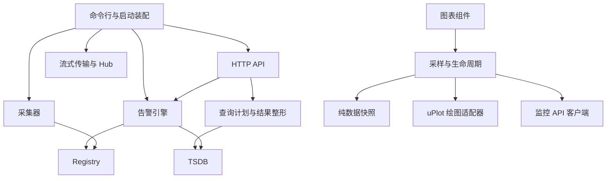

# 服务端与图表模块边界

本轮将启动装配、HTTP 查询、告警评估和图表采样拆成职责明确的模块。程序仍构建为同一个 `monitord`，保留现有 HTTP 路径、配置文件、告警日志和 TSDB 格式。Go 的 `internal/api`、`internal/health` 保持原包，内部协作接口不需要为拆文件而导出。

## 职责和依赖方向



`cmd/monitord` 是进程装配入口。配置到领域对象的适配发生在这里，告警与存储不反向读取 HTTP 服务或全局配置。没有引入全局服务定位器或新的外部依赖。

| 模块 | 所有者 | 维护约定 |
| --- | --- | --- |
| 命令行、备份、版本输出 | `cmd/monitord/main.go`、`identity.go` | 保持打包脚本和 linker stamp 的入口符号 |
| 启动、退出、重启 | `runtime.go`、`workers.go` | 获取资源后立即登记失败清理；所有 worker 共用取消上下文与退出期限 |
| 服务装配 | `api_setup.go`、`health_setup.go`、`hub_setup.go`、`stream_setup.go` | 只在此适配配置与领域类型；Hub 回调在 API 构造后才运行 |
| 自动命令 | `auto_command.go` | 白名单、超时、输出截断和审计统一由执行器负责 |
| HTTP 服务 | `api/server.go`、`routes.go`、`middleware.go` | 构造、分域路由、认证/RBAC 分开；注册顺序和权限不变 |
| 历史查询 | `data_parameters.go`、`data_plan.go`、`data_series.go`、`data_anomaly.go`、`data_result.go` | HTTP 分发仅协调；参数、维度/tier 计划、序列读取、异常覆盖、结果编码各自负责 |
| 告警引擎 | `health/engine.go` | 构造、生命周期和规则绑定 |
| 告警计算和状态 | `engine_evaluate.go`、`engine_transition.go`、`metric_lookup.go` | 指标查询、表达式结果、延迟/重复/恢复状态分别处理 |
| 告警外围能力 | `alarm.go`、`alarm_log.go`、`engine_notify.go`、`engine_snapshot.go`、`engine_silence.go` | 模型、持久化、通知、读快照、静音各自集中 |
| 图表 | `MetricChart.vue`、`features/metrics/useMetricChart.ts` | 组件保留交互和模板；采样控制器持有请求、订阅与可见性生命周期 |
| 图表数据与绘制 | `model/chartSeries.ts`、`chartRenderer.ts` | 纯模型负责原始样本；适配器拥有 uPlot 和图例 DOM |

## 资源与并发约定

启动前先验证运行模式；端口仍在 TSDB 加载前绑定，`/healthz` 就绪门禁保持兼容。TSDB、告警引擎、审计日志、HTTP listener 和 API 后台任务必须有明确的关闭所有者，初始化中途失败也执行清理。`Server.Close` 并发幂等，取消并等待自监控和报表任务，并关闭 WebShell；注入的数据库等依赖仍归启动层所有。正常退出先取消工作上下文、停止 HTTP/API，再等待各 worker，最后关闭 TSDB 并释放数据目录锁。

`workerGroup` 统一跟踪采集、告警、插件、上报、Hub、集群、导出和发现任务。所有等待共用一个 5 秒截止时间，超时日志指出尚未退出的组件，已完成的任务不误报。

告警保持 `tickMu → mu` 的锁顺序：查库与表达式计算在读写锁外，状态提交受锁保护，随后发布事件。查询组件对可替换的 anomaly provider 只捕获一次，避免单次查询内不同维度混用新旧来源。`Engine.Close` 继续幂等。

图表的历史结果、实时尾部、统计、CSV 和触摸查看共用同一份 `ChartSeries`。堆叠只是绘图投影，不改变导出与统计的原始单位；缺失值保留 `null`。取消、代次校验、离屏缓存回收和订阅清理归采样控制器统一管理。

## 防止重新耦合

`core/internal/architecture/dependencies_test.go` 使用 Go AST 扫描全部平台的生产文件，显式检查包之间允许的依赖。基础模块不可反向依赖 API、配置或启动入口；新跨域依赖需要在允许表中明确评审。检查包含在 `go test ./...` 和 `make test` 中，支持 `-trimpath`。

前端沿用 `npm run check:architecture`，新增 `features/*/model/` 约束：只依赖同域模型与 API 纯类型契约，不引用 Vue、组件、请求客户端或生命周期控制器。现有循环依赖、API 与 UI 分层约束继续生效。

新功能应先确定数据、状态和资源的所有者，再扩展对应模块。只有需要隔离独立能力或建立明确依赖方向时才新增包；避免为文件行数增加转发层。

## 验证入口

先构建 Web，再编译与测试 Go，避免替换嵌入资源时并发编译：

```sh
make all
make test
cd core && go test -trimpath ./internal/architecture
```

针对性回归包括启动中途失败后的 socket/目录锁/后台任务清理、worker 取消与共同期限、告警 provider 替换、数据 API 版本别名、稀疏数据、参数边界和存储层级覆盖。真实服务验收复用默认认证、告警规则、运维和持久化脚本；图表验收覆盖采样模型、历史、对比、单位、导出、手机尺寸和离屏缓存。

本轮目标是可维护性和资源生命周期完整性；文件缩短不代表未经测量的响应速度、CPU 或内存收益。平台采集器、TSDB 内部实现和 Flutter 客户端仍保留现有结构，不将局部拆分表述为全项目已无技术债。

## 本轮验收记录（2026-10-23）

- 使用 Go 1.27.1、Node 24.19.0，生产 Web 和本机服务端构建通过。
- `make test` 全部通过：12 项打包测试、Go vet、24 个包的竞态回归、14 项前端架构测试和 TypeScript 检查。后端依赖检查额外通过 `go test -trimpath ./internal/architecture`。
- `make cross` 8 个目标全部编译通过：Linux amd64/arm64、macOS amd64/arm64、Windows amd64、FreeBSD amd64/arm64、Android arm64；这是编译证据，不是这些系统的运行验收。
- Chrome 桌面/手机配置下共 116 项通过：7 个图表 spec 60 项，5 个模块 spec 56 项。包括真实服务历史读取、原始单位/CSV、离屏回收、请求取消、节点切换迟到响应，以及 `saved.revision` 和 stale 概览禁写行为。
- 默认认证脚本验证 9 个受保护入口、WebSocket 拒绝未授权访问、密码持久化及损坏时拒绝启动。
- 持久化脚本通过真实进程崩溃恢复、活动目录禁止备份、备份还原及重启历史逐行一致性检查。
- 运维、告警规则脚本通过真实采样、权限、并发冲突、批量原子操作、记录/视图持久化和两次规则重启恢复。
- Hub 本机模拟 10/100 节点环形摄入及历史重启一致性通过；该结果不等同于百台真实 Agent 接入。外部通知服务与真实移动设备不在本次验收范围。
